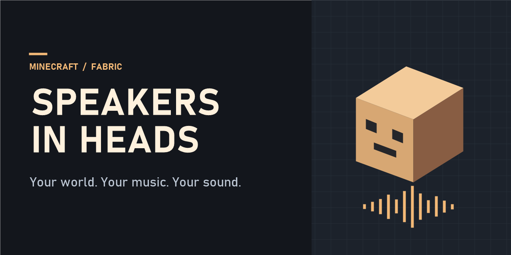

  

<strong>0.8.0 Public Beta</strong> · Minecraft 26.3 · Fabric · Java 25 · MIT

<a href="README.md">English</a> · <a href="README.ru.md">Русский</a>

# SpeakersInHeads

Turn Minecraft player heads into spatial speakers. Play your own music in a room, give a street a shared soundtrack with a Speaker Group, or place two heads as the left and right channels of a stereo pair.

[**Download from GitHub Releases**](../../releases) · [Installation](docs/en/INSTALLATION.md) · [User guide](docs/en/USER_GUIDE.md) · [Troubleshooting](docs/en/TROUBLESHOOTING.md)

> [!IMPORTANT]
> SpeakersInHeads runs on your Minecraft client. Every player who wants to use it needs the mod and their own audio files. Groups synchronize within a client. Playing a track does not send that track or your playback commands to other players.

## Features

| Feature | In game |
| --- | --- |
| Local library | MP3, Ogg Vorbis and supported PCM WAV files |
| Speaker Groups | Shared playback controls and group volume, with a separate spatial source at each head |
| Stereo pairs | Separate physical left and right heads with one pair volume |
| Playback | Play, pause, resume, seek, repeat, shuffle, Sync Now and continuation across chunk unloads |
| Spatial audio | Configurable range, wall muffling and underwater filtering. Optional Sound Physics Remastered integration for reflections |
| Presentation | Graphite, Amethyst, Amber and Frost themes, with adjustable animation intensity |
| Smart Music Import | Local matching, separate metadata and audio status, import of authorized direct audio files |

## Install and play

1. Use a **Minecraft Java Edition 26.3** profile with **Java 25**, [Fabric Loader](https://fabricmc.net/use/installer/) and [Fabric API](https://modrinth.com/mod/fabric-api) for 26.3. The validation setup used Loader 0.20.1 and Fabric API 0.166.2+26.3.
2. Put the runtime JAR in that profile’s `mods` folder. Leave the sources JAR outside `mods`.
3. Place a player head or wall-mounted player head. Hold **Shift** and right-click it, then open **Music Mixer**.
4. Open **Manage Library → Open Music Folder** and add your tracks. Use **Refresh Library** once copying completes, choose a track, and press **Play**.
5. Use the group controls in the mixer to create or join a group. Use stereo pair setup to choose separate left and right heads. To set range and full-volume distance, open **Settings → Spatial Audio**.

## Compatibility and import

Sound Physics Remastered is optional. SpeakersInHeads can apply wall and underwater filtering without SPR. See [Compatibility](docs/en/COMPATIBILITY.md) for the tested environment and limitations.

Smart Music Import can read supported metadata, look for a match in your library, or import a direct MP3, Ogg Vorbis, or supported WAV link when the audio can be legally downloaded. A Spotify track page can supply metadata. It does not provide an audio file for import.

## FAQ

- **Why is a track missing?** Confirm you used the active profile’s `music/speakersinheads` directory, wait for the copy to finish, and refresh.
- **Why is there no sound?** Check SIH volume, the Minecraft sound category you selected, the group or pair volume, and your distance from the head.
- **Why does Shift + right-click do nothing?** Check that the client loaded the mod and the block is a player head or wall-mounted player head.
- **Can I use this on Paper or Aternos?** Yes, the mod runs on the client. Set up playback separately on each device.
- **How do I update or report a bug?** See [Installation](docs/en/INSTALLATION.md) and [Troubleshooting](docs/en/TROUBLESHOOTING.md).

## Credits

Created and maintained by **klxsh**. SpeakersInHeads uses the [MIT license](LICENSE). See [third-party notices](THIRD_PARTY_NOTICES.md) for the bundled MP3 decoder and platform libraries.
