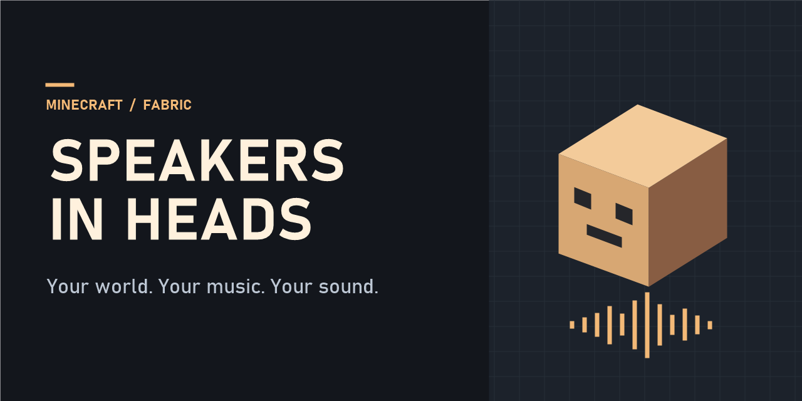

  

<strong>0.8.0 Public Beta</strong> · Minecraft 26.3 · Fabric · Java 25 · MIT

<a href="README.md">English</a> · <a href="README.ru.md">Русский</a>

# SpeakersInHeads

Преврати головы игроков в пространственные колонки. Включи свою музыку в комнате, озвучь улицу группой колонок или собери стереопару с отдельными левым и правым каналами.

[**Скачать в GitHub Releases**](../../releases) · [Установка](docs/ru/INSTALLATION.md) · [Руководство](docs/ru/USER_GUIDE.md) · [Диагностика](docs/ru/TROUBLESHOOTING.md)

> [!IMPORTANT]
> SpeakersInHeads работает на клиенте Minecraft. Каждому игроку нужны свой экземпляр мода и свои аудиофайлы. Группы синхронизируются внутри одного клиента. Выбор трека и команды воспроизведения остаются на твоём устройстве.

## Возможности

| Возможность | В игре |
| --- | --- |
| Музыкальная библиотека | MP3, Ogg Vorbis и поддерживаемый PCM WAV |
| Группы колонок | Общие управление и громкость, отдельный пространственный источник у каждой головы |
| Стереопары | Отдельные левая и правая головы с одной громкостью пары |
| Воспроизведение | Пауза, продолжение, перемотка, повтор, перемешивание, Sync Now и сохранение позиции при выгрузке чанков |
| Пространственный звук | Настраиваемая дальность, приглушение через стены и под водой. Совместимость с Sound Physics Remastered для отражений |
| Интерфейс | Темы Graphite, Amethyst, Amber и Frost с настройкой интенсивности анимаций |
| Smart Music Import | Поиск в локальной библиотеке, отдельные статусы метаданных и аудио, импорт разрешённых прямых ссылок |

## Как начать

1. Подготовь профиль **Minecraft Java Edition 26.3** с **Java 25**, [Fabric Loader](https://fabricmc.net/use/installer/) и [Fabric API](https://modrinth.com/mod/fabric-api) для 26.3. Сборку проверяли с Loader 0.20.1 и Fabric API 0.166.2+26.3.
2. Положи основной JAR в папку `mods` этого профиля. JAR с исходниками в `mods` не нужен.
3. Поставь голову игрока на пол или стену. Нажми **Shift + ПКМ**, затем открой **Music Mixer**.
4. Открой **Manage Library → Open Music Folder** и добавь треки. Дождись завершения копирования, нажми **Refresh Library**, выбери трек и нажми **Play**.
5. В микшере можно создать группу или присоединиться к существующей. Для стереопары выбери левую и правую головы. Дальность и расстояние полной громкости настраиваются в **Settings → Spatial Audio**.

## Совместимость и импорт

Sound Physics Remastered устанавливается по желанию. SpeakersInHeads может приглушать звук через стены и под водой и без SPR. Версии и ограничения описаны в разделе [Совместимость](docs/ru/COMPATIBILITY.md).

Smart Music Import читает доступные метаданные, ищет совпадения в библиотеке и может импортировать разрешённый для скачивания файл по прямой ссылке. Ссылка на трек Spotify может дать метаданные. Из такой ссылки SMI не получает аудиофайл.

## Частые вопросы

- **Почему трек не появился?** Проверь, что скопировал файл в `music/speakersinheads` активного профиля, дождись завершения копирования и обнови библиотеку.
- **Почему нет звука?** Проверь громкость SIH и выбранной категории Minecraft, громкость группы или пары и расстояние до головы.
- **Почему не работает Shift + ПКМ?** Проверь, что клиент загрузил мод, а блок является головой игрока или настенной головой игрока.
- **Можно ли играть на Paper или Aternos?** Да. Мод работает на клиенте, воспроизведение настраивается отдельно на каждом устройстве.
- **Как обновить мод или сообщить об ошибке?** См. [Установка](docs/ru/INSTALLATION.md) и [Диагностика](docs/ru/TROUBLESHOOTING.md).

## Авторы

Создатель и сопровождающий проекта — **klxsh**. SpeakersInHeads распространяется под [лицензией MIT](LICENSE). Сведения о декодере MP3 и платформенных библиотеках собраны в [уведомлениях о зависимостях](THIRD_PARTY_NOTICES.md).
